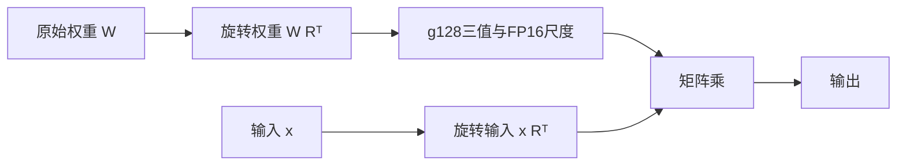

# Q38 实验记录（2026-10-19—2026-10-20）

> 归档说明：本页保留拆分前课程正文及各阶段观察，供追查失败、资源限制和验证口径。文中的“当前”“待完成”“仍为32步”只描述该段对应的历史时刻，不表示任务仍在运行。当前状态见[课程首页](README.md)，按顺序复刻见[训练指南](GUIDE.md)。
>
> 截至2026-10-20：旧32步版已公开；新96步检查点保存、实际恢复与压缩重载通过，独立生成完成0/8题，质量仍未通过。旧机器结果不并入新机器的步数。

## 拆分前课程正文

这条新实验从原始 **Qwen3.8-27B** 出发，实现带固定旋转的三值量化训练。官方 Bonsai 2 27B 本身已经以 Qwen3.8-27B 为底座，可以作为最终参照；本目录不是官方训练代码，也没有复现其98.2%能力保持率。[官方发布说明](https://prismml.com/news/bonsai-2-27b)

**当前已跑通32步全矩阵QAT、压缩导出、完整检查点保存、独立无损恢复和单卡推理；尚未恢复可用的整体质量。** 402个FP32主权重的原始字节哈希、优化器和Torch/Python/CUDA随机状态恢复通过；恢复模型与对应压缩产物在同一固定验证行的最后位置logits逐位相同。约5.85GB压缩产物与约79.5GB检查点保留，见[恢复及八提示结果](../../docs/experiments/2026-10-20-Q38-checkpoint-verified-eight-prompts.json)。

这是独立重做的32步，固定8段WikiText验证KL为 **6.1937→1.0055**。原始训练进程因私有调度器4小时总上限在恢复阶段终止；随后单独读取保存产物完成验证，没有再更新参数。[超时记录](../../docs/experiments/2026-10-20-Q38-mapped32-restore-timeout.json)保留当时未恢复的状态。此前另一台机器也完成32步，但保存时失联，最终结果未知；两次步数不能相加。两步控制时的空回答同样保留在[历史记录](../../docs/experiments/2026-10-19-Q38-full27-control.json)。

八提示采用相同聊天模板、关闭thinking、greedy、KV缓存、最多32个新token。两道算术、短翻译和仅输出OK正确；中文量化定义把量化混同保存检查点，首都回答有正确城市名但违反只答城市名的指令。五个小型严格文本检查通过四个，**不能当作能力保持率**；另三条概念回答还需语义审阅，部分达到长度上限。[原始BF16同题对照](../../docs/experiments/2026-10-20-Q38-matched-BF16-eight-prompts.json)已完成：同一输入token下，原模型正确说明降低数值精度，也只回答“北京”并结束；量化模型在这两项退化。原始BF16的三条概念回答同样达到32 token上限，截断本身不能归因于量化。这些开发题不能用于证明未来训练的独立泛化。更广的中英文上下文续训已实际开始：旧32步检查点恢复后已完成64次追加更新、累计96步；新检查点实际回读及压缩重载前向一致性通过。独立生成首题触发私有显存保护，完成0/8题，等待空闲卡补测，见[恢复通过及生成中止记录](../../docs/experiments/2026-10-20-Q38-mixed96-restored-generation-guard.json)。固定验证有下降也有反弹，整体质量尚未通过。

全部1657个模型张量在CUDA，唯一存储约5.45GiB；八条短请求首token之后约0.665–0.696 tokens/s。这里逐层展开压缩权重，计算峰值约24.49GiB，尚无融合内核或服务吞吐结论。CPU卸载BF16对照的耗时不能拿来推导全CUDA速度提升。已验证的[同题BF16入口](diagnose_original_prompts.py)要求指定量化诊断文件及其SHA256，检查八条输入token完全一致。

## 独立核对已保存产物

下面三个新文件就是本次完整27B实际执行并核对哈希的源码：[恢复验证](verify_saved_checkpoint.py)、[八提示诊断](diagnose_prompts.py)、[固定提示](diagnostic-prompts.json)。其余23个训练与元数据文件保持原版本，身份见[source-provenance.json](source-provenance.json)。旧32步权重已在[Hugging Face](https://huggingface.co/aden1350/Qwen3.8-27B-BonsaiStyle-Ternary-QAT-Experimental)公开；新增[infer_prompt.py](infer_prompt.py)支持任意短文本与CPU文件校验，GPU复验待空闲卡，运行步骤见[完整部署指南](../../docs/DEPLOYMENT.md)。

```bash
# 先确认所选卡空闲，环境与训练一致。选择新的输出目录。
# 以下哈希由你自己的训练记录取得；不要用教学记录的哈希代替本地产物身份。
CUDA_VISIBLE_DEVICES=0 python courses/qwen38_bonsai2/verify_saved_checkpoint.py \
  --model /path/to/Qwen3.8-27B --data /path/to/batches.json \
  --checkpoint /path/to/run/checkpoint-final --packed /path/to/run/packed \
  --output /path/to/new-restore-check --expected-step 32 \
  --checkpoint-manifest-sha256 "$CHECKPOINT_MANIFEST_SHA256" \
  --packed-manifest-sha256 "$PACKED_MANIFEST_SHA256" \
  --teacher-cache-sha256 "$TEACHER_CACHE_SHA256"

# 恢复检查通过后，启动独立进程生成。也可对自己的压缩产物单独诊断。
CUDA_VISIBLE_DEVICES=0 python courses/qwen38_bonsai2/diagnose_prompts.py \
  --packed /path/to/run/packed --tokenizer /path/to/Qwen3.8-27B \
  --prompts courses/qwen38_bonsai2/diagnostic-prompts.json \
  --output /path/to/new-eight-prompt-check
```

恢复器针对本课程的固定模型版本、g128/1024旋转、Adafactor无一阶动量、lr1e-5/4步warmup和最多32步的映射梯度试验。它重新核验全部27个原始文件，重建旋转基底并恢复402个FP32主权重、优化器和随机状态；不分配训练梯度工作区，也不继续训练。需要约155.04GiB匿名内存预算及额外容器已有内存，验证过程中显存/磁盘仍需余量。

本次验证的前向参照是保存产物对应的packed模型；原训练进程保存前的live logits已经不可取得，不能声称与其比较。这个恢复检查器本身不更新参数，也没有续训CLI。后续独立的[混合上下文续训入口](continue_mixed.py)已实际完成恢复后的整模更新；与原进程不中断执行的下一步逐位对照仍未验证。检查点恢复通过与生成质量通过分别记录。

## 换机：用本地文件保存FP32梯度

另一台5090有空闲卡，但容器内存配额为226GiB，原入口的主权重、梯度及36GiB余量预算放不下。新增的 `mapped_gradients.py` 保留FP32主权重、FP32梯度和同一Adafactor，把梯度放入Linux共享文件映射。梯度逻辑文件约100.10GiB；它是临时工作区，仍可能占用内核文件缓存，不是训练检查点。

每次反传前预分配梯度，反传后核对所有主权重确实收到梯度，优化器更新完成后才清零。清零通过 `MADV_REMOVE` 回收本次创建的稀疏梯度文件块；不会在反传中更新参数。使用本地文件系统，避免将这类临时梯度放在NFS目录。映射与共享缓冲的语义见[Python mmap](https://docs.python.org/3/library/mmap.html)和[PyTorch frombuffer](https://docs.pytorch.org/docs/stable/generated/torch.frombuffer.html)。

CPU累计梯度、四层原生CUDA检查点重算图的3次Adafactor更新已与普通内存方案对照：梯度、主权重和优化器状态一致；缺失反传会被拒绝。小规模无损检查点测试也通过。后续完整27B已完成32步映射梯度更新、导出和独立恢复；质量边界见上面的最新记录。

```bash
# 先确认所选GPU空闲；测试使用Linux本地临时目录。
CUDA_VISIBLE_DEVICES=0 python courses/qwen38_bonsai2/test_mapped_gradients.py

# 沿用前面准备的原始模型和32/8段WikiText输入，输出选择本地工作盘。
CUDA_VISIBLE_DEVICES=0 python courses/qwen38_bonsai2/recovery_pilot_mapped.py \
  --model /path/to/Qwen3.8-27B --data /path/to/batches.json \
  --output /path/on/local-disk/qwen38-mapped --steps 32 --lr 0.00001
```

新入口另计约155.04GiB的主权重、最大工作张量及匿名内存余量预算，再计入容器已有匿名/共享内存；这是准入计算，尚非实测训练峰值。原始模型下载后，磁盘准入还要求约200.19GiB，用于梯度文件、压缩导出、检查点上限和余量。实际部署显存及吞吐另测。

它会在压缩导出后先用独立进程尝试生成，再保存和恢复最终无损检查点；生成内容与恢复检查分别记录。该入口没有从上一轮检查点继续训练的CLI，也不意味着上一轮检查点已可用。换机运行重新核验同一固定版本的全部原始文件，保持数据、学习率和量化范围不变。该入口已在全部原始文件校验后自动启动，当前结果以日期快照和后续验证为准。

下载期间曾有一个HTTP/2分片断流；旧下载器按提交顺序取线程结果，未及时汇总该错误。已保留分片并以新任务改用HTTP/1.1、断点重试和及时失败处理，小型重试、损坏拒收及取消测试通过。**这次只改私有下载调度，23个公开训练与元数据文件保持一致**；全部原始文件校验前仍不启动训练。见[下载修复记录](../../docs/experiments/2026-10-19-Q38-download-retry-repair.json)。

## 与原35B/122B路线的区别

| 项目 | 本实验 |
|---|---|
| 模型 | 64层稠密文本骨干；不训练视觉塔和MTP |
| 量化范围 | embedding、LM head、MLP、attention及主要线性注意力投影，共402个矩阵、26,869,760,000个权重 |
| 保留路径 | `in_proj_a/b`、conv1d、A_log/dt_bias、归一化等，共26,238,464个文本参数 |
| 表示 | g128三值、FP16尺度、1024宽度固定符号/Hadamard旋转 |
| 训练 | FP32主权重和STE；不是冻结三值基座的低秩补偿 |
| 基础控制优化器 | 无动量SGD，CPU存放主权重与梯度，CUDA执行前后向；仅做两次更新 |
| 导出 | 本项目的base-3打包格式；不兼容官方GGUF，不能直接交给官方Bonsai二进制 |
| 推理参考 | 解包单个矩阵后计算，尚无融合低比特内核或正式性能结论 |

旋转与保留边界依据[官方白皮书](https://github.com/PrismML-Eng/Bonsai-demo/blob/330450a1a120bbfb2dd3b0f0bbc4315a7dbc8120/bonsai-2-27b-whitepaper.pdf)和[固定版本的公开模型配置](https://huggingface.co/prism-ml/Ternary-Bonsai-2-27B-mlx-2bit/blob/fcba37d2117a7077eac6b613b2668d14d9779edd/config.json)。本项目自行选择固定符号、Lloyd初始化、`KL+0.1×状态MSE`和控制优化器；公开资料没有给出可直接执行的完整训练配方，不把这些选择写成官方做法。

计算保留BF16文本骨干，旋转以FP32累加，尺度以FP16保存。数学表示、混合精度执行和融合内核性能分别验证；已有小模型结果不能代替完整27B或官方运行时的一致性证明。

## 为什么输入和权重要一起旋转

对行向量，令`R=H·S/√1024`。先把原权重变成`W·Rᵀ`，每次线性计算把输入变成`x·Rᵀ`。没有量化时，两侧旋转相消；加入三值投影后，会产生需要训练恢复的误差。



embedding还有一个易错点：查到的是旋转基底中的向量，输出前要做逆旋转。固定符号与Hadamard的顺序不能随意交换；`test_core.py`同时检查正向、逆向以及错误顺序会产生差异。

按402个实际矩阵的形状计算，本格式的代码、尺度、逐矩阵符号和BF16保留张量合计约 **5.45GiB**，不含文件元数据、缓存或运行临时空间。实际完整27B产物约5.4487GiB，CUDA模型张量约5.4477GiB，与预算吻合。参考运行时会展开矩阵，单个最大FP32展开就约4.74GiB，还有整数解包中间量；本次独立进程的PyTorch计算峰值约24.48GiB，显著大于常驻权重。

## 先检查小规模机制

使用已安装根目录依赖的Linux环境，从仓库根目录运行：

```bash
CUDA_VISIBLE_DEVICES='' python courses/qwen38_bonsai2/test_core.py
CUDA_VISIBLE_DEVICES='' python courses/qwen38_bonsai2/test_native.py
python courses/qwen38_bonsai2/test_source.py
```

CPU检查覆盖5120宽度旋转等价、embedding逆旋转、三值打包padding、损坏编码拒绝、STE梯度、内存中的master/Adam/RNG恢复后下一步一致，以及四层原生Qwen的训练和内存导出重载。后两项使用小模型，不加载27B权重。

只有确认所选GPU空闲后，再运行CUDA控制：

```bash
CUDA_VISIBLE_DEVICES=0 python courses/qwen38_bonsai2/test_offload.py
```

它验证CPU主权重经CUDA计算后的梯度、BF16输出与打包表示一致、四层原生图的检查点重算，以及一次BF16缓存解码对照。缓存对照是容差检查，不能宣称逐位一致或27B缓存已验证。实际实验在独占的空闲卡上运行，另有UUID锁、时间、显存和进程组清理控制；运行上面的裸命令不会自动替你预约GPU。

## 真实权重块控制：数值通过，损失上升

已用原始27B的第0层线性注意力块和第3层完整注意力块，分别更新6/7个三值矩阵两次，梯度有限、保留参数不变、内存打包重载输出逐位一致。输入是原始embedding的0..127索引，不是能力题，也不是前面各层产生的第3层真实输入。

但AdamW、lr1e-4下，第一/第二次更新前的块输出归一化MSE分别为 **0.1991→4.2099** 和 **0.4397→0.6642**。第二次更新后的最终MSE未记录，不能将这两个数当作训练前/后成绩；已观察到的不利趋势仍要求更低学习率及其他优化器对照，不直接启动此设置的长训。见[原始结果与限制](../../docs/experiments/2026-10-19-Q38-real-blocks.json)。

```bash
CUDA_VISIBLE_DEVICES=0 python courses/qwen38_bonsai2/check_real_blocks.py \
  --model /path/to/Qwen3.8-27B \
  --index /path/to/Qwen3.8-27B/model.safetensors.index.json \
  --source-proof original-source-proof.json --output real-block-control.json \
  --optimizer adamw --lr 0.000001 --steps 2
```

这是单独两块的基础控制，不能计为整个27B模型完成了训练。显存也属于块训练，不是完整模型部署占用。

后续同权重/同输入控制已补齐两步后的最终MSE：AdamW1e-6下，第0/3层分别为 **0.1991→0.1687**、**0.4397→0.4160**；SGD1e-3下为 **0.1991→0.1885**、**0.4397→0.4356**。所有打包输出仍一致，初始前向损失和梯度范数相同。改用`--optimizer sgd --lr 0.001`可运行SGD对照。它们只证明该固定输入上的块损失下降，见[完整对照](../../docs/experiments/2026-10-19-Q38-block-lr-controls.json)。

官方公开的是高精度保留边界，并不等于宣布这些参数在训练时冻结。本目录冻结它们是基础控制选择；正式训练需另行研究。

## 核对原始模型和资源

原始模型固定为 `Qwen/Qwen3.8-27B` 的提交 `1d4bf0f2ff6012fd82039f2fa52739d0dd7c60c0`。在独立模型目录下载该版本的权重、配置和tokenizer，然后核对：

```bash
python courses/qwen38_bonsai2/verify_source.py \
  --model /path/to/Qwen3.8-27B --output original-source-proof.json

CUDA_VISIBLE_DEVICES='' python courses/qwen38_bonsai2/plan.py \
  --config /path/to/Qwen3.8-27B/config.json \
  --index /path/to/Qwen3.8-27B/model.safetensors.index.json \
  --output qwen38-meta-plan.json
```

[source-files.json](source-files.json)保留27个文件的固定Hub LFS SHA256/Git blob身份；验证器只读本地文件，不下载模型，也不初始化CUDA。形状审计在meta设备构造架构，不加载权重。

标准FP32主权重、梯度与两个Adam动量仅训练矩阵就需 **400.390625GiB**，另有激活、保留参数和临时空间。因此最初计划使用两张空闲B300；当前可访问的B300均被其他任务占用。不要把整机RAM、容器配额、GPU剩余显存视为同一个数。

## 完整27B的两步控制：训练与导出流程已验证

为利用当前空闲5090，另准备了CPU卸载基础控制。CPU主权重与梯度约200.20GiB，脚本还额外要求36GiB临时空间及余量，并计入同容器已有匿名/共享内存。通过预算检查才能执行。它采用SGD以避免Adam动量的资源开销，**不代表标准Adam QAT能在这台机器上运行**。

```bash
CUDA_VISIBLE_DEVICES=0 python courses/qwen38_bonsai2/control.py \
  --model /path/to/Qwen3.8-27B \
  --source-manifest original-source-proof.json \
  --output qwen38-control --steps 2 --seq-len 128 --lr 0.001
```

控制输入是代码中三段自编教学文本，前两段各做一次更新，第三段仅验证；每段128token。它检查所有402个矩阵的有限梯度、保留张量不变、同GPU量化网格导出及重新构造后的末位置logits。产物只保存压缩权重，**没有完整可恢复主权重检查点**，也不构成充分的质量恢复训练。

通过后，在新进程检查单卡推理：

```bash
CUDA_VISIBLE_DEVICES=0 python courses/qwen38_bonsai2/infer_control.py \
  --packed qwen38-control/packed --tokenizer /path/to/Qwen3.8-27B \
  --output fresh-inference.json --max-new-tokens 16
```

以上命令已在完整27B上正常退出：两步各检查了402个有限CPU梯度，保留张量哈希不变，导出后重新构造的末位置全部logits逐位一致。两次更新耗时约246秒、253秒；未参与更新的那一段VAL文本上，KL从7.0558降到6.1547，归一化状态MSE从1.3733降到1.3624。每一步TRAIN使用不同文本，不能把两步TRAIN损失直接当作下降曲线，也不能用单段VAL代替能力评测。

独立进程检查确认1657个模型参数/缓冲张量全部在CUDA，没有CPU权重卸载。测量结果如下：

| 测量 | 本次结果 |
|---|---:|
| 压缩文件总大小，含元数据 | 5.4487GiB |
| 去重后的CUDA模型张量存储 | 5.4477GiB |
| 独立推理的PyTorch分配峰值 | 24.4762GiB |
| 独立推理采样NVML used峰值 | 26166MiB，约25.55GiB |
| 驱动另保留 | 498MiB |
| 生成 | 首token即结束符，解码文本为空 |
| 首token后的解码速度 | 未测得；没有后续token |

**这次证明完整架构能够更新、压缩和执行，尚未证明模型可用。** 空回复是需要继续处理的实际结果，不将正常进程退出写成质量成功。原始BF16同提示对照随后正常输出了“模型量化是通过降低模型参数和激活值的数值精度……”的前16token；原模型使用CPU卸载，其耗时不作为单卡纯GPU速度对照。真实数据恢复训练、可恢复检查点及独立能力评测仍需继续；正式部署还需要真正执行压缩格式的推理内核。完整文件已逐个重新核对哈希，两步控制的GPU锁与进程组已释放，见[原始测量摘要与限制](../../docs/experiments/2026-10-19-Q38-full27-control.json)。

实际运行加入了真实块SGD对照通过的前置条件，以及新进程推理时所有模型张量必须位于CUDA的显式断言。[排队快照](../../docs/experiments/2026-10-19-Q38-full-control-queued.json)保留下载期间的状态；下载期间不占GPU，开始前重新检查空闲并持有UUID协作锁。私有调度器曾因文件命名遮蔽标准库而在CPU预检阶段失败，已清理自有进程并改名修复，未改变13个公开Python文件或中断其他任务；该失败也保留在完整控制记录中。

## 继续用真实数据：32步小试验与换机重做

新入口保留402个FP32主权重，改用无一阶动量的CPU Adafactor，其行/列二阶状态按形状约27.9MiB。主权重和梯度本身仍约200.20GiB，并非全部训练内存；还需保留参数、临时空间和已有任务的余量。该设置依据低内存优化器思路自行选择，不是官方Bonsai训练配方。[Adafactor原论文](https://arxiv.org/abs/1804.04235)

全量固定页内存的分配器取整预算约286GiB，无法和本容器已有任务一起放下；因此实际入口只复用一个64MiB固定页缓冲，CPU主权重和累计梯度仍使用普通内存。教师LM head放在CUDA，128token的KL在一次head调用中计算。小规模梯度、原生四层Adafactor更新和缓存检查已通过；完整27B的运行成本与效果仍要等本轮结果。[PyTorch固定页分配器说明](https://docs.pytorch.org/docs/main/generated/torch.cuda.memory.host_memory_stats.html)

在已有根目录依赖的Linux环境中，先准备数据依赖和固定输入：

```bash
python -m pip install -r courses/qwen38_bonsai2/requirements-data.txt
CUDA_VISIBLE_DEVICES='' python courses/qwen38_bonsai2/prepare_wikitext.py \
  --model /path/to/Qwen3.8-27B --data-root /path/to/qwen38-data \
  --output /path/to/qwen38-batches.json
```

数据来自[固定修订的Salesforce/WikiText](https://huggingface.co/datasets/Salesforce/wikitext/tree/b08601e04326c79dfdd32d625aee71d232d685c3/wikitext-2-raw-v1)，只读取train和validation，分别选择32/8个非重复段落；test不读取。原始Parquet按官方SHA256核对，输出记录段落索引、输入ID身份、tokenizer文件哈希和种子。本次准备结果的SHA256为`c0045ae0c85c193cd3476fbe95ca2504896f06c163d633f2a684ca2011d9b2a0`。数据不随仓库分发；数据卡保留其许可说明。

默认从主站下载，也可用`--endpoint https://hf-mirror.com`。若下载受限，可从同一固定修订取得两个文件，分别命名为`train.parquet`、`validation.parquet`放入数据目录，再用`--local-only`；仍须通过同一哈希检查。

先在Linux CPU检查主权重、Adafactor、随机状态的磁盘恢复、错误基底和损坏文件拒绝；再确认GPU空闲，检查缓冲后端：

```bash
CUDA_VISIBLE_DEVICES='' python courses/qwen38_bonsai2/test_recovery_checkpoint.py
CUDA_VISIBLE_DEVICES=0 python courses/qwen38_bonsai2/test_buffered_staging.py
```

原机器32步试验使用下面的入口；更新已完成，最终检查点与生成结果仍未知。换机重做使用前述独立的`recovery_pilot_mapped.py`入口。**两者均未作为完成质量恢复的整模配方验收。**

```bash
CUDA_VISIBLE_DEVICES=0 python courses/qwen38_bonsai2/recovery_pilot.py \
  --model /path/to/Qwen3.8-27B --data /path/to/qwen38-batches.json \
  --output /path/to/qwen38-recovery-pilot --steps 32 --lr 0.00001
```

学习率用4步预热至1e-5，采用优化器内部RMS裁剪，每8步检查8段VAL；若平均KL超过初始值的1.5倍，提前结束更新。32段只提供4096个训练token，是很小的英文蒸馏试验，不代表中文、代码或智能体能力恢复。两个真实块上的Adafactor对照已有损失下降，但不能替代整模结果。

训练结束后，入口计划先导出压缩权重，再以“原始旋转FP32主权重与当前主权重逐位异或→gzip”保存无损差分、Adafactor和随机状态。恢复时必须重建完全相同的原始基底，并核对基底和恢复后字节身份；这是存储压缩，不是降低检查点精度。小CPU样例的下一次更新已逐位一致，**这一原始启动阶段的整模检查点验证当时尚未完成；后续已完成保存与独立恢复，另一个混合上下文入口也已实际续训。原进程不中断执行的下一步逐位对照仍未验证。** 当前入口只在结束时保存检查点，尚无命令行续训选项；通用`load_checkpoint`函数单独提供。

模型已在本地后，程序还要求约100GB空闲磁盘，包含80GB检查点上限、新压缩产物和12GiB余量。实际差分若触及上限会停止并保留部分文件。原始权重、数据和输出应放在仓库外。预算日志复用了旧控制的SGD标签，实际执行类是代码中的Adafactor；记录已明确校正该标签，不将其误写成SGD试验。

当前代码与旧两步控制的`offload.py`可选构造类型、推理入口说明不同；确切源码身份和历史版本分开保存在[source-provenance.json](source-provenance.json)。本轮完成或失败后添加新的结果记录，不改写启动快照。

## 文件阅读顺序

`rotation.py` → `ternary.py` → `policy.py` → `plan.py` → `offload.py` → `control.py` → `infer_control.py`。继续真实数据路线时再读`prepare_wikitext.py` → `buffered_staging.py` → `recovery_checkpoint.py` → `recovery_pilot.py`。源码身份和已经验证的范围见[source-provenance.json](source-provenance.json)。权重、凭证、机器入口与私有日志不在仓库中。

## 同题原始BF16对照

```bash
# 一张已协调空闲的卡，并为原始权重准备CPU内存；选择新输出目录。
CUDA_VISIBLE_DEVICES=0 python courses/qwen38_bonsai2/diagnose_original_prompts.py \
  --model /path/to/Qwen3.8-27B \
  --prompts courses/qwen38_bonsai2/diagnostic-prompts.json \
  --quantized-diagnostics /path/to/new-eight-prompt-check/summary.json \
  --quantized-diagnostic-sha256 "$QUANTIZED_DIAGNOSTIC_SHA256" \
  --output /path/to/new-original-reference
```

它只运行推理，重新核验原始文件与量化对照身份，拒绝不同输入token。实际原始文本权重约53.74GB存于CPU、保留张量约52.48MB在CUDA，矩阵按需复制；这是质量对照，不能据此计算全CUDA推理加速比。

## 中英文上下文续训实验：96步产物恢复通过，生成与质量待验证

[新队列快照](../../docs/experiments/2026-10-20-Q38-mixed-continuation-queued.json)对应这里的新增源码，与旧32步入口分开。变长序列的KL归一化、检查点重算梯度和小型Adafactor恢复后下一步对照已在CPU通过；**完整续训产物已验证保存与恢复，实际生成和质量仍待验证**。教师80条状态已完成并逐位回读，续训已重新检查空闲、接锁，恢复原检查点和402个优化器计数，并实际新增64步、累计96步；新压缩权重已导出，约81.34GB检查点保存与实际回读、对应压缩重载前向通过。最新已验证可恢复版本为96步，实际生成仍待完成。旧WikiText验证子组初值与原32步结果完全一致。完整开发验证轨迹见本节末尾，历史快照不改写。原[首次续训快照](../../docs/experiments/2026-10-20-Q38-first-resumed-updates.json)保留新增3步时的状态，原排队快照保留新增0步；[首次更新后验证](../../docs/experiments/2026-10-20-Q38-first-mixed-validation.json)记录新第8步、累计40步的结果，分别列出当前运行与可恢复保存步数。

[教学对话](mixed-contexts.json)是为本实验合成编写的32条中英文训练上下文和8条验证上下文，涉及解释、改写、摘要、简单代码等；不复制八提示的题目与答案。它与原32/8段WikiText交错，得到64条训练序列（5687 token）和16条验证序列（1384 token），长度28–128，不填充。数据设计受到已看过的开发题影响，后续不能拿这些题宣称独立泛化。

```bash
CUDA_VISIBLE_DEVICES='' python courses/qwen38_bonsai2/prepare_mixed_contexts.py \
  --model /path/to/Qwen3.8-27B --wikitext /path/to/original-batches.json \
  --contexts courses/qwen38_bonsai2/mixed-contexts.json \
  --diagnostic-prompts courses/qwen38_bonsai2/diagnostic-prompts.json \
  --output /path/to/new-mixed-batches.json

# 先检查GPU空闲并协调占卡。所有输出必须使用新目录。
CUDA_VISIBLE_DEVICES=0 python courses/qwen38_bonsai2/prepare_mixed_teacher.py \
  --model /path/to/Qwen3.8-27B --data /path/to/new-mixed-batches.json \
  --data-sha256 "$MIXED_DATA_SHA256" --output /path/to/new-mixed-teacher

CUDA_VISIBLE_DEVICES='' python courses/qwen38_bonsai2/test_mixed_objective.py
CUDA_VISIBLE_DEVICES='' python courses/qwen38_bonsai2/test_recovery_checkpoint.py

# 此入口已完成64次追加更新及新检查点回读；生成质量待验证。要求原32步恢复证明和教师缓存。
CUDA_VISIBLE_DEVICES=0 python courses/qwen38_bonsai2/continue_mixed.py \
  --model /path/to/Qwen3.8-27B --data /path/to/new-mixed-batches.json \
  --data-sha256 "$MIXED_DATA_SHA256" \
  --teacher-cache /path/to/new-mixed-teacher/teacher_states.pt \
  --teacher-cache-sha256 "$MIXED_TEACHER_CACHE_SHA256" \
  --resume-checkpoint /path/to/original-run/checkpoint-final \
  --resume-manifest-sha256 "$ORIGINAL_CHECKPOINT_MANIFEST_SHA256" \
  --resume-data /path/to/original-batches.json --resume-packed /path/to/original-run/packed \
  --resume-proof /path/to/original-restore-check/summary.json \
  --resume-proof-sha256 "$ORIGINAL_RESTORE_PROOF_SHA256" \
  --output /path/on/local-disk/new-mixed-run --steps 64
```

续训保留原Adafactor状态，以lr1e-5继续，不重新warmup。它要求原检查点为本课程固定版本、旧32步及同一旧数据/教师身份（这一冻结入口还固定旧教师缓存SHA256为记录中的563ad9a…，其他身份的检查点需另行适配与验证）；先逐位核对原固定验证行的最后位置logits与独立恢复证明，再更新。402个优化器计数必须从32继续递增；新更新数和累计数分别记录。最多追加64步，完整跑完才累计96步。

每8次新更新分别检查对话和WikiText验证KL，任一来源超过各自初值1.5倍即提前停止更新。每个序列的KL除以实际长度，状态MSE保持原定义；这仍是全部实际位置的蒸馏，没有掩码或硬标签损失。

新检查点上限单独设为120GB，因为更多FP32权重变化后，原80GB压缩上限可能不足；原检查点保留。原始模型以外，新工作盘准入约237.44GiB，含107.48GB临时梯度、120GB检查点预算、6GB导出及20GiB余量；匿名内存准入仍约155.04GiB加容器已有内存。私有队列为初始化、续训、导出及恢复合计留8小时，裸命令不提供GPU预约或这个时间限制。

### 首次更新后验证：对话KL下降，WikiText KL上升

这是固定16条验证序列的新第8步结果；首次验证快照记录的运行进度为新第10步、累计42步，两者时间点不同。每组都是8条序列指标的算术平均。

| 来源 | 更新前KL | 新8步后KL | 行级变化 | 更新前/后状态MSE |
|---|---:|---:|---|---:|
| 合成中英文对话 | 2.8565 | 2.5240 | 5条下降，3条上升 | 0.6656 / 0.7213 |
| 固定WikiText | 1.0055 | 1.0710 | 1条下降，7条上升 | 0.4756 / 0.4858 |

对话组平均KL下降约11.6%，WikiText组上升约6.5%；状态MSE两组都上升，不能只报改善的一组。两组KL均未达到各自初值1.5倍的预设停止线，冻结训练器按原计划继续。它仍只是小型开发验证，尚无新压缩产物的独立生成、完整质量或未见评测结果。全部精确值与逐行损失见上面的日期记录。

### 追加训练中点：保留下降与反弹的完整轨迹

截至[中点快照](../../docs/experiments/2026-10-20-Q38-mixed-continuation-midpoint.json)，已新增33步、累计65步；最近一次完整验证在新第32步、累计64步，完整已保存检查点仍为32步。

| 新更新数 | 累计更新数 | 对话组KL | WikiText组KL | 对话组状态MSE | WikiText组状态MSE |
|---:|---:|---:|---:|---:|---:|
| 0 | 32 | 2.8565 | 1.0055 | 0.6656 | 0.4756 |
| 8 | 40 | 2.5240 | 1.0710 | 0.7213 | 0.4858 |
| 16 | 48 | 0.6654 | 1.0260 | 0.6358 | 0.4686 |
| 24 | 56 | 0.5708 | 1.0143 | 0.5973 | 0.4635 |
| 32 | 64 | 0.7324 | 1.0739 | 0.6061 | 0.4686 |

第32步两组KL均比第24步上升，WikiText组也高于本轮初值；对话组仍低于初值。这不是单调改善。预设停止线以各组初值的1.5倍计算，尚未触发，当前冻结实验继续按原计划运行。

这里采用固定顺序：前32次新更新是16条中文问句对话与16段WikiText交错，后32次是以英文问句为主的其余对话与剩余WikiText交错，没有随机打散。它是本轮条件，不能从中点把变化归因于单一因素。

当前只在最终保存检查点，因此第24步虽有目前最低的总体开发验证目标，也没有对应的完整保存产物，不能称为可恢复的最优模型。最终新导出、检查点回读、独立生成仍待完成；另外已排队的答案内容与结束符条件KL检查也尚未执行GPU测量。这些小型开发损失不等同于回答质量或能力保持率。

### 64次追加更新结束：导出完成，检查点验证待完成

[阶段快照](../../docs/experiments/2026-10-20-Q38-mixed64-updates-exported-saving.json)记录已完成的64次新更新、累计96步，以及全部402个矩阵在每步的有限梯度检查。共消费本轮5687个训练token。保留参数哈希未改变，新压缩文件合计5,850,462,420字节；这是导出完成，回读和生成验证仍待执行。

| 新更新数 | 累计更新数 | 对话组KL | WikiText组KL | 对话组状态MSE | WikiText组状态MSE |
|---:|---:|---:|---:|---:|---:|
| 0 | 32 | 2.8565 | 1.0055 | 0.6656 | 0.4756 |
| 8 | 40 | 2.5240 | 1.0710 | 0.7213 | 0.4858 |
| 16 | 48 | 0.6654 | 1.0260 | 0.6358 | 0.4686 |
| 24 | 56 | 0.5708 | 1.0143 | 0.5973 | 0.4635 |
| 32 | 64 | 0.7324 | 1.0739 | 0.6061 | 0.4686 |
| 40 | 72 | 0.6801 | 1.0126 | 0.6013 | 0.4658 |
| 48 | 80 | 0.9403 | 1.0279 | 0.5959 | 0.4675 |
| 56 | 88 | 0.9532 | 1.0817 | 0.6122 | 0.4838 |
| 64 | 96 | 0.7775 | 1.0804 | 0.6003 | 0.4846 |

最终对话KL低于本轮初值，WikiText KL高于初值，过程并不单调。最低总体目标仍在新第24步，但没有对应中途检查点。第64步的损失不代表能力保持率，也不能推断实际回答已经修好。

截至这个快照，新完整检查点正在写入，尚未完成回读、训练权重与恢复权重的前向对照、对应压缩权重重载和八提示独立生成。最新完整可恢复版本仍为旧32步。后续答案位置诊断继续等待这些步骤成功后才使用GPU；质量验收仍需实际语义和独立未见评测。

### 96步保存与恢复通过，生成因显存保护中止

[后续记录](../../docs/experiments/2026-10-20-Q38-mixed96-restored-generation-guard.json)确认新检查点81,336,645,366字节已保存并实际回读，恢复权重与训练权重在固定验证前向逐位相同，对应压缩重载也相同。最新保存及已验证可恢复步数均为96；这些检查不等同于与原进程不中断执行的下一次优化器更新逐位对照。

独立生成已经加载同一压缩产物，但首题完成前触发私有调度器显存保护：采样占用30,656MiB超过30,000MiB上限，未观察到CUDA OOM异常。完成0/8题，没有可报告的新回答或速度。进程退出且锁释放后，第3卡仍占26,214MiB；容器无法看到对应占用进程，来源尚未确认。未中断其他任务，也未放宽保护线。

依赖该生成成功的答案位置诊断在GPU使用前退出，GPU结果与新诊断源码仍未发布。等待空闲卡后应只重做只读生成和诊断，复用已有96步产物，不重复训练。先前保存中快照和32步生成结果分别保留，新版本质量仍未通过。
