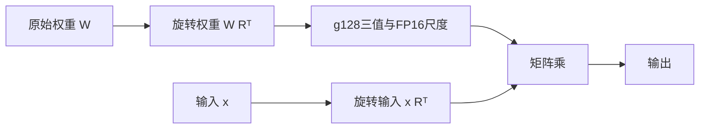

# Qwen3.8-27B：Bonsai 2 机制与训练控制

这条新实验从原始 **Qwen3.8-27B** 出发，实现带固定旋转的三值量化训练。官方 Bonsai 2 27B 本身已经以 Qwen3.8-27B 为底座，可以作为最终参照；本目录不是官方训练代码，也没有复现其98.2%能力保持率。[官方发布说明](https://prismml.com/news/bonsai-2-27b)

**当前阶段是训练机制与资源控制，完整27B的两步控制尚待原始权重下载完成。正式恢复训练、完整能力评测及部署加速尚未完成。** 最近状态见[2026-10-19控制记录](../../docs/experiments/2026-10-19-Q38-controls.json)。

## 与原35B/122B路线的区别

| 项目 | 本实验 |
|---|---|
| 模型 | 64层稠密文本骨干；不训练视觉塔和MTP |
| 量化范围 | embedding、LM head、MLP、attention及主要线性注意力投影，共402个矩阵、26,869,760,000个权重 |
| 保留路径 | `in_proj_a/b`、conv1d、A_log/dt_bias、归一化等，共26,238,464个文本参数 |
| 表示 | g128三值、FP16尺度、1024宽度固定符号/Hadamard旋转 |
| 训练 | FP32主权重和STE；不是冻结三值基座的低秩补偿 |
| 基础控制优化器 | 无动量SGD，CPU存放主权重与梯度，CUDA执行前后向；仅做两次更新 |
| 导出 | 本项目的base-3打包格式；不兼容官方GGUF，不能直接交给官方Bonsai二进制 |
| 推理参考 | 解包单个矩阵后计算，尚无融合低比特内核或正式性能结论 |

旋转与保留边界依据[官方白皮书](https://github.com/PrismML-Eng/Bonsai-demo/blob/330450a1a120bbfb2dd3b0f0bbc4315a7dbc8120/bonsai-2-27b-whitepaper.pdf)和[固定版本的公开模型配置](https://huggingface.co/prism-ml/Ternary-Bonsai-2-27B-mlx-2bit/blob/fcba37d2117a7077eac6b613b2668d14d9779edd/config.json)。本项目自行选择固定符号、Lloyd初始化、`KL+0.1×状态MSE`和控制优化器；公开资料没有给出可直接执行的完整训练配方，不把这些选择写成官方做法。

计算保留BF16文本骨干，旋转以FP32累加，尺度以FP16保存。数学表示、混合精度执行和融合内核性能分别验证；已有小模型结果不能代替完整27B或官方运行时的一致性证明。

## 为什么输入和权重要一起旋转

对行向量，令`R=H·S/√1024`。先把原权重变成`W·Rᵀ`，每次线性计算把输入变成`x·Rᵀ`。没有量化时，两侧旋转相消；加入三值投影后，会产生需要训练恢复的误差。



embedding还有一个易错点：查到的是旋转基底中的向量，输出前要做逆旋转。固定符号与Hadamard的顺序不能随意交换；`test_core.py`同时检查正向、逆向以及错误顺序会产生差异。

按402个实际矩阵的形状计算，本格式的代码、尺度、逐矩阵符号和BF16保留张量合计约 **5.45GiB**，不含文件元数据、缓存或运行临时空间。这是格式预算，尚非完整27B产物的测量。参考运行时会展开矩阵，单个最大FP32展开就约4.74GiB，还可能有整数解包中间量；不能据此承诺运行显存等于权重体积。

## 先检查小规模机制

使用已安装根目录依赖的Linux环境，从仓库根目录运行：

```bash
CUDA_VISIBLE_DEVICES='' python courses/qwen38_bonsai2/test_core.py
CUDA_VISIBLE_DEVICES='' python courses/qwen38_bonsai2/test_native.py
python courses/qwen38_bonsai2/test_source.py
```

CPU检查覆盖5120宽度旋转等价、embedding逆旋转、三值打包padding、损坏编码拒绝、STE梯度、内存中的master/Adam/RNG恢复后下一步一致，以及四层原生Qwen的训练和内存导出重载。后两项使用小模型，不加载27B权重。

只有确认所选GPU空闲后，再运行CUDA控制：

```bash
CUDA_VISIBLE_DEVICES=0 python courses/qwen38_bonsai2/test_offload.py
```

它验证CPU主权重经CUDA计算后的梯度、BF16输出与打包表示一致、四层原生图的检查点重算，以及一次BF16缓存解码对照。缓存对照是容差检查，不能宣称逐位一致或27B缓存已验证。实际实验在独占的空闲卡上运行，另有UUID锁、时间、显存和进程组清理控制；运行上面的裸命令不会自动替你预约GPU。

## 真实权重块控制：数值通过，损失上升

已用原始27B的第0层线性注意力块和第3层完整注意力块，分别更新6/7个三值矩阵两次，梯度有限、保留参数不变、内存打包重载输出逐位一致。输入是原始embedding的0..127索引，不是能力题，也不是前面各层产生的第3层真实输入。

但AdamW、lr1e-4下，第一/第二次更新前的块输出归一化MSE分别为 **0.1991→4.2099** 和 **0.4397→0.6642**。第二次更新后的最终MSE未记录，不能将这两个数当作训练前/后成绩；已观察到的不利趋势仍要求更低学习率及其他优化器对照，不直接启动此设置的长训。见[原始结果与限制](../../docs/experiments/2026-10-19-Q38-real-blocks.json)。

```bash
CUDA_VISIBLE_DEVICES=0 python courses/qwen38_bonsai2/check_real_blocks.py \
  --model /path/to/Qwen3.8-27B \
  --index /path/to/Qwen3.8-27B/model.safetensors.index.json \
  --source-proof original-source-proof.json --output real-block-control.json \
  --optimizer adamw --lr 0.000001 --steps 2
```

这是单独两块的基础控制，不能计为整个27B模型完成了训练。显存也属于块训练，不是完整模型部署占用。

后续同权重/同输入控制已补齐两步后的最终MSE：AdamW1e-6下，第0/3层分别为 **0.1991→0.1687**、**0.4397→0.4160**；SGD1e-3下为 **0.1991→0.1885**、**0.4397→0.4356**。所有打包输出仍一致，初始前向损失和梯度范数相同。改用`--optimizer sgd --lr 0.001`可运行SGD对照。它们只证明该固定输入上的块损失下降，见[完整对照](../../docs/experiments/2026-10-19-Q38-block-lr-controls.json)。

官方公开的是高精度保留边界，并不等于宣布这些参数在训练时冻结。本目录冻结它们是基础控制选择；正式训练需另行研究。

## 核对原始模型和资源

原始模型固定为 `Qwen/Qwen3.8-27B` 的提交 `1d4bf0f2ff6012fd82039f2fa52739d0dd7c60c0`。在独立模型目录下载该版本的权重、配置和tokenizer，然后核对：

```bash
python courses/qwen38_bonsai2/verify_source.py \
  --model /path/to/Qwen3.8-27B --output original-source-proof.json

CUDA_VISIBLE_DEVICES='' python courses/qwen38_bonsai2/plan.py \
  --config /path/to/Qwen3.8-27B/config.json \
  --index /path/to/Qwen3.8-27B/model.safetensors.index.json \
  --output qwen38-meta-plan.json
```

[source-files.json](source-files.json)保留27个文件的固定Hub LFS SHA256/Git blob身份；验证器只读本地文件，不下载模型，也不初始化CUDA。形状审计在meta设备构造架构，不加载权重。

标准FP32主权重、梯度与两个Adam动量仅训练矩阵就需 **400.390625GiB**，另有激活、保留参数和临时空间。因此最初计划使用两张空闲B300；当前可访问的B300均被其他任务占用。不要把整机RAM、容器配额、GPU剩余显存视为同一个数。

## 完整27B的两步控制：实验入口，尚未完成验证

为利用当前空闲5090，另准备了CPU卸载基础控制。CPU主权重与梯度约200.20GiB，脚本还额外要求36GiB临时空间及余量，并计入同容器已有匿名/共享内存。通过预算检查才能执行。它采用SGD以避免Adam动量的资源开销，**不代表标准Adam QAT能在这台机器上运行**。

```bash
CUDA_VISIBLE_DEVICES=0 python courses/qwen38_bonsai2/control.py \
  --model /path/to/Qwen3.8-27B \
  --source-manifest original-source-proof.json \
  --output qwen38-control --steps 2 --seq-len 128 --lr 0.001
```

控制输入是代码中三段自编教学文本，前两段各做一次更新，第三段仅验证；每段128token。它检查所有402个矩阵的有限梯度、保留张量不变、同GPU量化网格导出及重新构造后的末位置logits。产物只保存压缩权重，**没有完整可恢复主权重检查点**，也不构成充分的质量恢复训练。

通过后，在新进程检查单卡推理：

```bash
CUDA_VISIBLE_DEVICES=0 python courses/qwen38_bonsai2/infer_control.py \
  --packed qwen38-control/packed --tokenizer /path/to/Qwen3.8-27B \
  --output fresh-inference.json --max-new-tokens 16
```

完整27B入口目前已经排队，但尚未加载真实模型或产生优化器更新；这些命令保留为实验代码，不能视为已经验证的27B运行配方。后续完成和失败都写入新日期记录，不覆盖现有控制证据。正式训练还需要合适的数据、优化器/检查点方案、独立质量评测，以及真正执行压缩格式的推理内核。

排队版本已加入真实块SGD对照通过的前置条件，以及新进程推理时所有模型张量必须位于CUDA的显式断言，见[最新队列快照](../../docs/experiments/2026-10-19-Q38-full-control-queued.json)。下载期间不占GPU，开始前会重新检查空闲并持有UUID协作锁；其他任务先占用时不会被中断。

## 文件阅读顺序

`rotation.py` → `ternary.py` → `policy.py` → `plan.py` → `offload.py` → `control.py` → `infer_control.py`。源码身份和已经验证的范围见[source-provenance.json](source-provenance.json)。权重、凭证、机器入口与私有日志不在仓库中。
